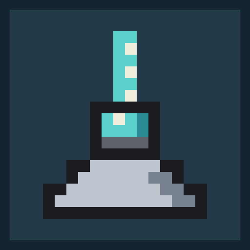

# Beaconhold

NeoForge mod: more functions for the beacon (no hostile spawns, loaded chunks) and an API for other mods.

## State

The mod is in development. It has an API for other mods ([docs/api.md](docs/api.md)), and the function "no hostile spawns". The rules and the planned functions are in [docs/design.md](docs/design.md).

## Contribute

Read [CONTRIBUTING.md](CONTRIBUTING.md) for the workflow, the build, the tests and the versions.

## License

[MIT](LICENSE)
